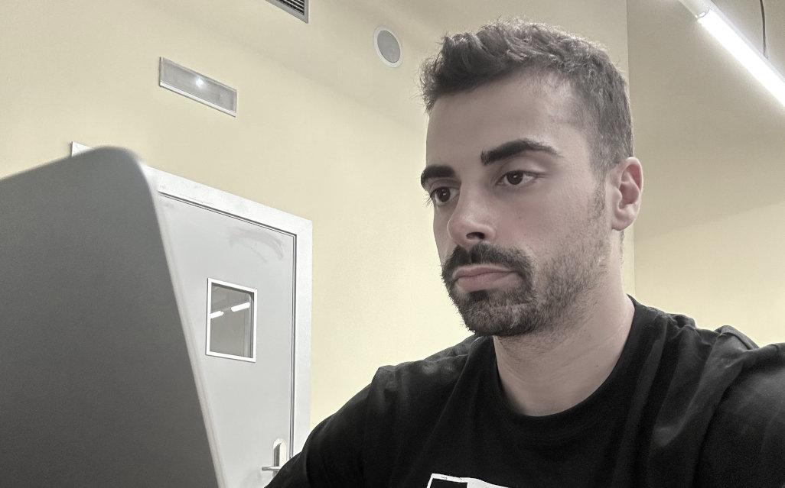

## Long story short

Learning by doing, ever since I was a toddler

I've always loved to tinker. As a toddler, I could spend hours playing with cables and taking gadgets apart. When I was 12, my dad brought home a broken computer and I immediately wanted to fix it. I opened it up and started poking at the components, but I switched the power supply's input voltage and caused a small explosion when I plugged it in. That moment showed me how much I wanted to understand what was happening inside those mysterious metal boxes.

A few years into university, I knew classes weren't enough. I wanted hands-on experience, so I took on all kinds of projects, from teaching robotics to school students to volunteering on the network team at Campus Party Europe in Berlin.

I also like stepping out of my comfort zone. In 2022, I faced one of my biggest fears: giving my first talk in front of hundreds of people. I found I loved the feeling afterwards, and it changed how I approach challenges: now I go looking for them.
